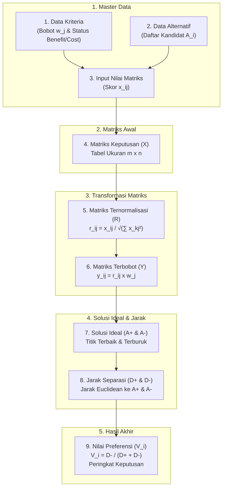

# App-TOPSIS

Sistem Pendukung Keputusan (SPK) berbasis web menggunakan metode **TOPSIS** (*Technique for Order of Preference by Similarity to Ideal Solution*) dengan arsitektur modern PHP 8.3, MySQL 8.0, dan komputasi in-memory berkinerja tinggi.

[](https://www.php.net/)
[](https://www.mysql.com/)
[](https://www.docker.com/)
[](LICENSE)

---


---

## Ringkasan

App-TOPSIS dirancang untuk membantu pengambilan keputusan multi-kriteria secara objektif. Menggunakan antarmuka responsif CoreUI yang dilengkapi dukungan mode gelap/terang, panel navigasi terstruktur, serta visualisasi 9 tahapan komputasi matematis TOPSIS dari data mentah hingga perangkingan akhir.

> [!NOTE]
> **Kredensial Akun Default:**
> - URL: `http://localhost/`
> - Username: `admin`
> - Password: `123`

---

## Alur Komputasi TOPSIS

Sesuai visualisasi dasbor antarmuka pengguna di atas, alur keputusan diproses melalui 9 modul terintegrasi:



1. **Data Kriteria**: Penentuan kriteria evaluasi beserta bobot preferensi ($w_j$) dan jenis atribut (*Benefit* atau *Cost*).
2. **Data Alternatif**: Pengelolaan daftar entitas atau kandidat yang akan dievaluasi.
3. **Input Nilai Matriks**: Pengisian nilai kuantitatif untuk setiap pasangan alternatif terhadap kriteria.
4. **Nilai Matriks ($X$)**: Tabulasi matriks keputusan berukuran $m \times n$.
5. **Nilai Matriks Ternormalisasi ($R$)**: Transformasi elemen matriks menggunakan pembagi Euclidean vektor:
   $$r_{ij} = \frac{x_{ij}}{\sqrt{\sum_{k=1}^{m} x_{kj}^2}}$$
6. **Nilai Bobot Ternormalisasi ($Y$)**: Perkalian matriks ternormalisasi dengan bobot kriteria:
   $$y_{ij} = r_{ij} \times w_j$$
7. **Nilai Solusi Ideal ($A^+ / A^-$)**: Penentuan titik ideal positif ($A^+$) dan titik ideal negatif ($A^-$) berdasarkan atribut kriteria.
8. **Jarak Solusi Ideal ($D^+ / D^-$)**: Perhitungan jarak Euclidean setiap alternatif ke solusi ideal:
   $$D_i^+ = \sqrt{\sum (y_{ij} - y_j^+)^2}, \quad D_i^- = \sqrt{\sum (y_{ij} - y_j^-)^2}$$
9. **Nilai Preferensi ($V$)**: Perhitungan kedekatan relatif alternatif dan perankingan akhir:
   $$V_i = \frac{D_i^-}{D_i^+ + D_i^-}$$

---

## Fitur Utama

- **In-Memory Calculation Engine**: Seluruh tahapan komputasi dihitung langsung dalam memori RAM ($O(M \times N)$) tanpa query database N+1 berulang.
- **Import Data CSV Streaming**: Impor data massal kriteria, alternatif, dan matriks nilai menggunakan native parser `fgetcsv` tanpa pustaka eksternal yang berat.
- **Keamanan Data**: Dilengkapi perlindungan token anti-CSRF, sanitasi output terhadap XSS, dan prepared statement PDO di semua modul transaksi.
- **Relational Integrity**: Skema database InnoDB MySQL 8.0 dengan composite primary key dan relasi foreign key `ON DELETE CASCADE`.
- **Ekspor & Cetak Laporan**: Tampilan cetak hasil analisis keputusan siap pakai untuk dokumentasi resmi.

> [!TIP]
> Template CSV untuk Kriteria, Alternatif, dan Matriks Nilai dapat diunduh langsung melalui halaman **Import Data CSV** di aplikasi atau melalui direktori `src/samples/`.

---

## Kebutuhan Sistem

- [Docker](https://docs.docker.com/get-docker/) & [Docker Compose](https://docs.docker.com/compose/)
- Port `80` (HTTP) dan port `3306` (MySQL) tersedia di komputer lokal.

---

## Panduan Instalasi & Menjalankan

### 1. Klon Repositori

```bash
git clone https://github.com/machfudin37/App-Topsis.git
cd App-Topsis
```

### 2. Konfigurasi Lingkungan (Opsional)

File konfigurasi default telah disediakan dalam `docker-compose.yml`. Salin `.env.example` jika ingin menyesuaikan kredensial:

```bash
cp .env.example .env
```

### 3. Jalankan Menggunakan Docker Compose

```bash
docker compose up -d --build
```

> [!IMPORTANT]
> Kontainer database MySQL secara otomatis menginisialisasi skema tabel dan akun admin default dari berkas `database/schema.sql` pada startup pertama.

### 4. Buka Aplikasi

Buka peramban web dan navigasikan ke:
```
http://localhost/
```

Masuk menggunakan username `admin` dan password `123`.

---

## Struktur Direktori

```text
app-topsis/
├── src/
│   ├── core/                      # Service layer modern
│   │   ├── Auth.php               # Autentikasi sesi & validasi CSRF
│   │   ├── CsvParser.php          # Streaming CSV parser (Kriteria, Alternatif, Matriks)
│   │   ├── Database.php           # PDO connection pool & singleton
│   │   └── TopsisEngine.php       # Mesin kalkulasi TOPSIS in-memory
│   ├── layout/                    # Komponen antarmuka (Header, Sidebar, Footer)
│   ├── samples/                   # File contoh template CSV
│   ├── index.php                  # Dashboard ringkasan & 9 modul kartu alur
│   ├── kriteria.php               # Manajemen master kriteria
│   ├── alternatif.php             # Manajemen master alternatif
│   ├── inputnilaimatriks.php      # Formulir input nilai matriks keputusan
│   ├── nilaimatriks.php           # Tabulasi matriks keputusan awal
│   ├── nilaipreferensi.php        # Pusat kalkulasi & laporan ranking TOPSIS
│   └── import.php                 # Modul upload CSV data master & matriks
├── database/
│   └── schema.sql                 # DDL MySQL 8.0 (InnoDB, FK Cascading, Seed Data)
├── docs/
│   ├── adr.md                     # Architecture Decision Records (ADR 001 - 005)
│   └── rancangan-modernisasi-topsis.md
├── tests/
│   └── test_topsis.py             # Script verifikasi matematis TOPSIS
├── Dockerfile                     # PHP 8.3 Apache + PDO MySQL
├── docker-compose.yml             # Orkestrasi kontainer aplikasi & database
├── user-interface.png             # Tangkapan layar antarmuka aplikasi
└── README.md
```

---

## Dokumentasi Teknis

Rincian keputusan arsitektur dan spesifikasi teknis dapat dilihat pada dokumen pendukung:
- [Architecture Decision Records (docs/adr.md)](docs/adr.md)
- [Dokumen Perancangan Teknis (docs/rancangan-modernisasi-topsis.md)](docs/rancangan-modernisasi-topsis.md)
